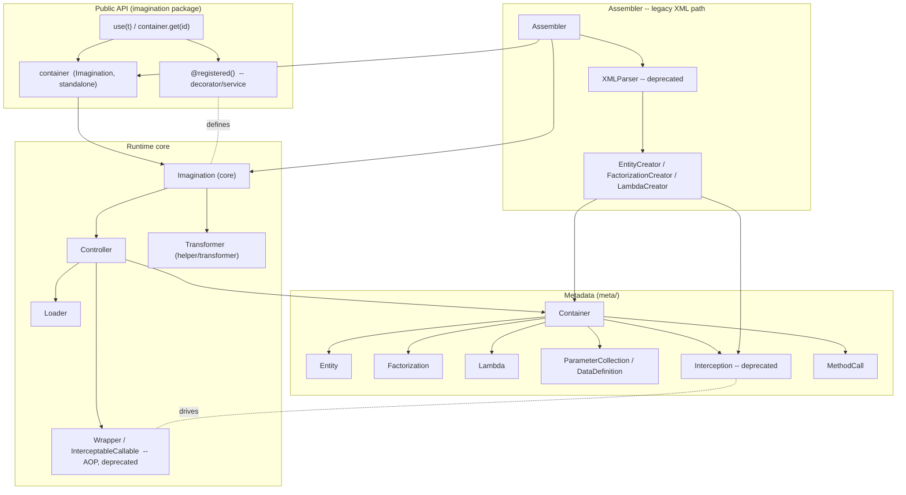
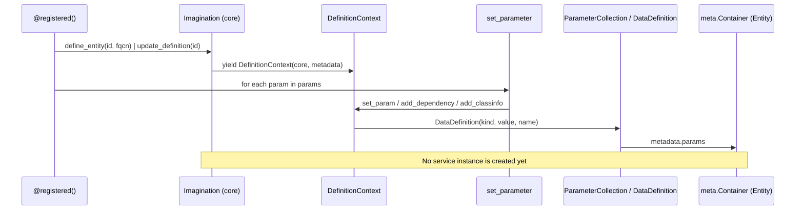
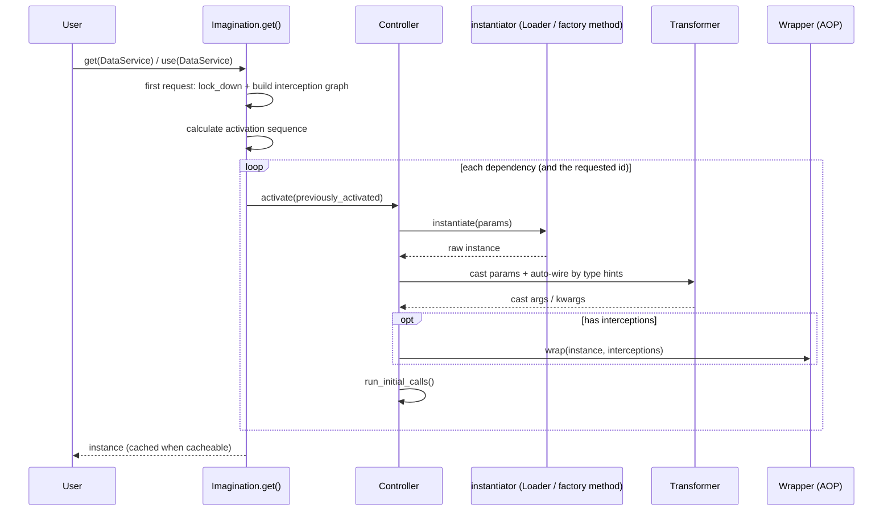
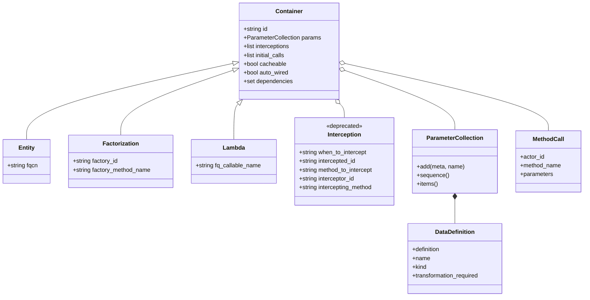
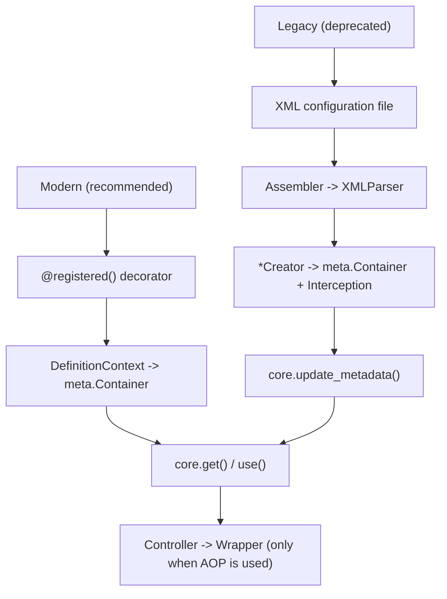

# Imagination -- Design & Architecture

This document explains how the pieces of **Imagination** relate to each other.
The diagrams below are written in [Mermaid](https://mermaid.js.org/), which
renders on GitHub and in most Mermaid-aware Markdown viewers.

> **Status of the two approaches.** The **standalone container** and the
> **`@registered` decorator** are the *recommended* way to use Imagination. The
> **XML configuration** approach and **aspect-oriented programming (AOP)**
> interception are *legacy support*: they still work but are marked `@deprecated`
> in the source and are not used by the recommended path. Nothing legacy is
> removed -- it is retained for backward compatibility and documented here.

## 1. Public entry points

The package exposes a small surface (see `imagination/__init__.py`):

| Symbol | Origin | Purpose |
| --- | --- | --- |
| `service` (`registered`) | `imagination.decorator.service` | Declare a class as a service. |
| `container` | `imagination.standalone` | The shared, ready-to-use core. |
| `use(type)` | `imagination.standalone` | Typed shortcut for `container.get(type)`. |

## 2. High-level architecture

## 3. Definition time -- how `@registered` builds a definition

When a class is decorated, the decorator turns the constructor and the explicit
`params` into metadata on the shared container. It does **not** instantiate the
service.

Key relationships:

- `registered` (decorator/service.py) computes the service ID with the default
  strategy `fully_qualified_class_name` (helper/id_naming.py) and then calls
  `Imagination.define_entity` / `update_definition`.
- Those are context managers that yield a `DefinitionContext`
  (helper/context.py); the decorator feeds each configured parameter through
  `set_parameter` (decorator/helper.py), which routes to
  `DefinitionContext.set_param` / `add_dependency` / `add_classinfo`.
- All of this only mutates a `meta.Container` (here an `Entity`); instantiation
  is deferred until the first request.

## 4. Request time -- activation flow of `get()` / `use()`

`use(ServiceClass)` and `container.get(ServiceClass)` share the same path. On the
first request the core locks down, builds the interception graph, computes the
activation sequence, and activates every dependency before the requested one.

Notes:

- The **instantiator** differs by container type (`Controller.instantiator`):
  - `Entity` -> `Loader(fqcn).package` (loader.py)
  - `Factorization` -> a method on the factory service
  - `Lambda` -> `Loader(fq_callable_name).package`
- **Auto-wiring** (`__scan_for_usable_parameters`) matches constructor parameters
  to registered services by type hint; `Transformer.cast` resolves entity
  references, environment variables, and primitive/collection values.
- **AOP** only happens when a service has interceptions: the raw instance is
  wrapped by `Wrapper` / `InterceptableCallable` (wrapper.py) so that
  *before/after/error* callbacks run without touching the object.

## 5. Metadata class hierarchy

## 6. Modern vs. legacy

The two approaches converge on the **same runtime core** (`Imagination` /
`Controller`). The only difference is *how the metadata is produced*:

- **Modern**: `@registered` builds the metadata in Python via `DefinitionContext`.
- **Legacy**: `Assembler` + `XMLParser` parse an XML file and produce the same
  `meta.Container` / `Interception` objects via the `*Creator` handlers.

## 7. What is marked `@deprecated`

The legacy surface is marked with a compatibility decorator
(`imagination/decorator/deprecated.py`) that re-exports the standard-library
`@deprecated` on Python 3.13+ and is a no-op "dummy" on older Python, so the
legacy code keeps working on every still-supported version:

- `imagination.wrapper.Wrapper` and `imagination.wrapper.InterceptableCallable`
  (AOP runtime) -- decorated at runtime.
- `imagination.meta.definition.Interception` (AOP metadata) -- decorated at
  runtime.
- `imagination.assembler.xml.XMLParser` (XML path) -- documented as deprecated
  (`.. deprecated::` in the docstring); it is not decorated at runtime because it
  is instantiated on the modern default path, where a runtime warning would be
  misleading.

Per the project's `AGENTS.md`, none of this is removed: the legacy modules are
retained and clearly documented.
